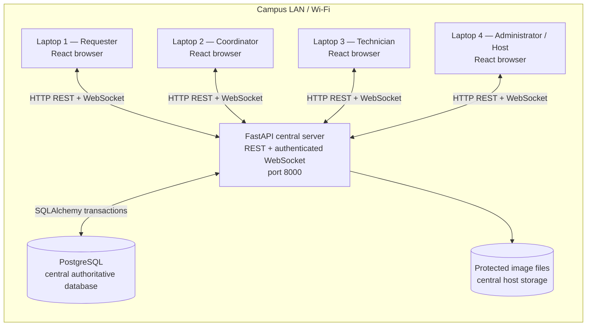
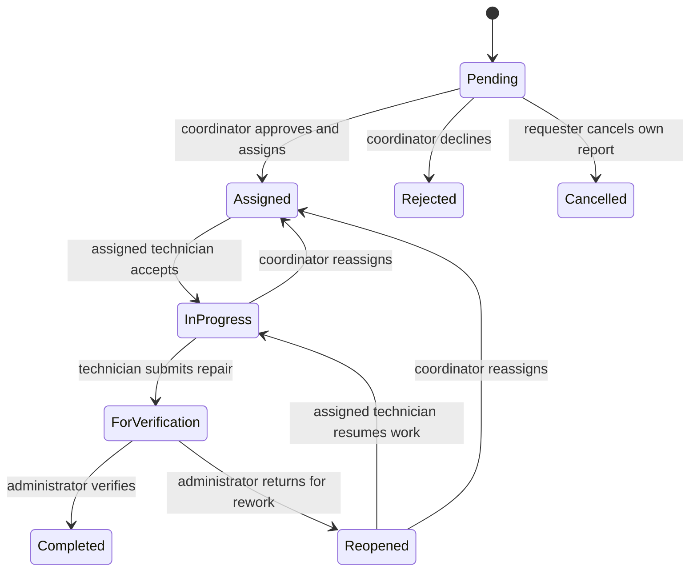

# Architecture, communication, and database

## System architecture

This is one unified React application served from the administrator's central FastAPI host. Each role uses a separate physical laptop and authenticated account; the application exposes only the operations allowed by that role. The other laptops do not run station APIs or connect directly to PostgreSQL.



### Responsibilities by computer

| Computer | Role-specific work |
|---|---|
| Laptop 1 | Submit reports/photos, cancel eligible pending reports, track notifications/status, queue a new report if the API is temporarily unavailable. |
| Laptop 2 | Review and reject/approve, set priority, route to a technician, reassign active work, monitor queue and workload. |
| Laptop 3 | Review assignments, submit repair progress and optional evidence, request verification, receive rework assignments. |
| Laptop 4 | Host API and PostgreSQL, create/disable accounts, see connected stations, review audit/CSV/analytics, verify or return work. |

## Message flow

```mermaid
sequenceDiagram
  participant R as Laptop 1 requester
  participant API as FastAPI on Laptop 4
  participant DB as PostgreSQL on Laptop 4
  participant C as Laptop 2 coordinator
  participant T as Laptop 3 technician
  participant A as Laptop 4 administrator
  R->>API: POST /api/requests (JWT, Idempotency-Key)
  API->>DB: Insert request + audit + notifications in one transaction
  DB-->>API: Commit and request ID
  API-->>C: Authenticated WebSocket event
  C->>API: POST /api/requests/{id}/review (approve + technician)
  API->>DB: Lock request row, check version, insert unique work order
  API-->>T: Work-order assignment notification
  T->>API: POST /api/work-orders/{id}/updates
  API->>DB: Update request/work order + repair update + audit
  API-->>A: Repair notification
  T->>API: Submit repair for verification
  A->>API: POST /api/work-orders/{id}/verify
  API->>DB: Validate transition and version; finalize or reopen
  API-->>R: Persisted notification; reconnect fetches authoritative status
```

## REST and WebSocket contracts

- REST paths are under `/api`; `/health` is unauthenticated service health.
- Login/register return a signed JWT. REST uses `Authorization: Bearer <token>`; the WebSocket authenticates with `?token=` because browser WebSocket APIs cannot set an authorization header.
- Request creation accepts `Idempotency-Key`. Replaying that operation from the same user returns the existing report.
- `POST /api/stations/heartbeat` stores the role/user/station and last seen timestamp. Laptop status is considered offline after 45 seconds. Clients heartbeat every 12 seconds.
- WebSocket notifications are sent only to authenticated users matching the target role or user ID. Notifications are stored in the database; a reconnecting client re-fetches its notification list and the relevant dashboard data.
- The frontend is served from the same origin as the API in production. The development Vite proxy is for local development only.

## Workflow state machine



The server rejects unsupported transitions. Requester cancellation is allowed only while pending. Verification is administrator-only. Coordinator review and work-order reassignment are online, version-checked operations.

## Database ERD

```mermaid
erDiagram
  USERS ||--o{ MAINTENANCE_REQUESTS : submits
  USERS ||--o{ WORK_ORDERS : assigned_to
  USERS ||--o{ REPAIR_UPDATES : writes
  USERS ||--o{ ATTACHMENTS : uploads
  USERS ||--o{ ACTIVITY_LOGS : performs
  USERS ||--o{ STATION_REGISTRY : operates
  USERS ||--o{ NOTIFICATIONS : receives
  MAINTENANCE_REQUESTS ||--o| WORK_ORDERS : creates
  MAINTENANCE_CATEGORIES ||--o{ MAINTENANCE_REQUESTS : categorizes
  CAMPUS_LOCATIONS ||--o{ MAINTENANCE_REQUESTS : locates
  MAINTENANCE_REQUESTS ||--o{ ATTACHMENTS : includes
  MAINTENANCE_REQUESTS ||--o{ NOTIFICATIONS : triggers
  WORK_ORDERS ||--o{ REPAIR_UPDATES : records
  WORK_ORDERS ||--o{ ATTACHMENTS : documents
  NOTIFICATIONS ||--o{ NOTIFICATION_RECEIPTS : read_by
  USERS ||--o{ NOTIFICATION_RECEIPTS : reads

  USERS {
    int id PK
    string email UK
    string password_hash
    string role
    bool is_active
  }
  MAINTENANCE_CATEGORIES {
    int id PK
    string name UK
    bool is_active
    datetime created_at
  }
  CAMPUS_LOCATIONS {
    int id PK
    string name UK
    bool is_active
    datetime created_at
  }
  MAINTENANCE_REQUESTS {
    int id PK
    string public_id UK
    int requester_id FK
    string category FK
    string building FK
    string status
    string priority
    string idempotency_key
    int version
  }
  WORK_ORDERS {
    int id PK
    string public_id UK
    int request_id FK_UK
    int technician_id FK
    string status
    int version
  }
  REPAIR_UPDATES {
    int id PK
    int work_order_id FK
    int author_id FK
    text note
  }
  ATTACHMENTS {
    int id PK
    string public_id UK
    int request_id FK
    int work_order_id FK
    int uploader_id FK
    string file_path
  }
  NOTIFICATIONS {
    int id PK
    int user_id FK
    string target_role
    string entity_id
  }
  NOTIFICATION_RECEIPTS {
    int id PK
    int notification_id FK
    int user_id FK
    datetime read_at
  }
  ACTIVITY_LOGS {
    int id PK
    int actor_id FK
    string action
    string entity_id
  }
  STATION_REGISTRY {
    string station_id PK
    int user_id FK
    datetime last_seen_at
  }
```

## Consistency and failure behavior

- PostgreSQL is the authoritative source of requests, assignments, updates, notifications, and audit records. Only FastAPI accesses it.
- Categories and campus locations are centralized admin-managed catalogs. New requests must reference active catalog entries; the request fields retain their names as foreign keys so deactivating an entry never removes historical labels.
- Request creation, audit event, and role notifications are committed together; assignment acceptance, repair updates, verification, and audit/notification records use the same transaction.
- A `UNIQUE` work-order `request_id` prevents two active work orders for one maintenance report. Coordinator review locks the report row and checks its version/status before assigning.
- The API increments integer versions and requires the version during review, reassignment, and verification. A stale browser receives HTTP 409 instead of silently overwriting a newer decision.
- Idempotency key uniqueness is scoped to the requester. A retry after a lost response returns the existing report.
- PostgreSQL row locks protect concurrent coordinator operations. SQLite does not provide equivalent lock behavior; automated tests validate workflow rules but not PostgreSQL concurrency.
- IndexedDB stores requester outbox items locally. Server records are not stored authoritatively in browser storage. A queued item remains until its REST request and optional photo are acknowledged.
- Laptop 4 is a single point of failure. During central API/database outage, saved central records remain on disk, but role actions that require server authorization pause. No availability/failover guarantee is made.
